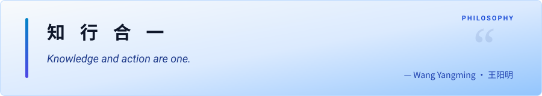

# Lyu Bingrong · 吕炳荣

<picture>
  <source media="(max-width: 480px) and (prefers-color-scheme: dark)" srcset="./assets/hero_tagline_mobile_dark.svg">
  <source media="(max-width: 480px)" srcset="./assets/hero_tagline_mobile_light.svg">
  <source media="(prefers-color-scheme: dark)" srcset="./assets/hero_tagline_dark.svg">
  <source media="(prefers-color-scheme: light)" srcset="./assets/hero_tagline_light.svg">
  
</picture>

  Software Engineering undergraduate at <strong>North University of China</strong>, working where <strong>LLM evaluation</strong>, <strong>AI engineering</strong>, and <strong>open-source product development</strong> meet. 
  I build AI systems that are measurable, reliable, and genuinely useful — and ship them to real users.

  
  
  
  

  
  
  
  
  

## 👋 About Me / 关于我

- 🧩 **Open-source maintainer** — Maintainer of [Clawd on Desk](https://github.com/rullerzhou-afk/clawd-on-desk), a cross-platform Electron app with **6k+ GitHub stars**; I own the Settings experience, multi-agent integrations, and Windows platform quality, with **66 merged PRs** since April 2026.
- 🛡️ **LLM evaluation & safety** — Former intern at the **Beijing Academy of Artificial Intelligence (BAAI)**, working on safety evaluation, adversarial attacks, human-preference data quality, and subjective benchmark design.
- 🏆 **Competition-proven** — National 1st Prize at the Challenge Cup AI track, National 2nd Prize at RAICOM, and two Kaggle bronze medals across model reasoning, low-resource translation, and recommendation.
- 🌏 **How I work** — Product-minded and documentation-first: I care about the details users actually feel, and I ship across Windows, macOS, and Linux.

## 💼 Experience / 实习经历

<table>
  <tr>
    <td width="100%">
      <strong>🧠 Intelligent Evaluation Intern · 智能评测实习生</strong> 
      <strong>Beijing Academy of Artificial Intelligence (BAAI) · Intelligent Evaluation Group</strong> &nbsp;·&nbsp; <code>2024.11 – 2025.03</code> 
      北京智源人工智能研究院 · 智能评测组
      <ul>
        <li>
          <strong>LLM Safety & Adversarial Research / 大模型安全与对抗研究：</strong>
          Conducted safety evaluations of large language models and researched adversarial attack strategies to probe model vulnerabilities and robustness boundaries; contributed to building systematic safety and robustness benchmarks. 
          开展大语言模型安全评测与对抗攻击研究，系统探测模型的安全漏洞与鲁棒性边界，参与构建体系化的安全性与鲁棒性评测基准。
        </li>
        <li>
          <strong>Annotation Quality Modeling / 匿名评测标注质量建模：</strong>
          Co-designed the user annotation quality scoring method for anonymous, arena-style LLM evaluation competitions — helping identify low-quality annotations and strengthen the reliability of the human preference data behind model rankings. 
          参与设计大模型匿名评测竞赛的用户标注质量计算方法，用于识别低质量标注、提升人类偏好数据的可信度，为模型排名的公正性提供支撑。
        </li>
        <li>
          <strong>Subjective Benchmark Design / 主观评测基准研讨：</strong>
          Participated in methodology discussions for subjective LLM benchmarks, contributing ideas on evaluation dimensions, scoring criteria, and protocol design. 
          参与大模型主观评测基准的方案研讨，围绕评测维度、评分标准与评测流程设计提出建议。
        </li>
      </ul>
      <strong>Focus / 核心领域：</strong> <code>LLM Safety Evaluation</code> · <code>Adversarial Attack &amp; Red Teaming</code> · <code>Arena Annotation Quality</code> · <code>Subjective Benchmarks</code>
    </td>
  </tr>
</table>

## 🚀 Featured Project / 代表项目

<a href="https://github.com/rullerzhou-afk/clawd-on-desk">
  <picture>
    <source media="(prefers-color-scheme: dark)" srcset="./assets/clawd_banner_dark.svg">
    <source media="(prefers-color-scheme: light)" srcset="./assets/clawd_banner_light.svg">
    
  </picture>
</a>

  A pixel desktop companion that reacts to <strong>Claude Code, Codex, Cursor, Copilot, Gemini</strong>, and 20+ other AI coding agents in real time.

  
  
  
  

**What I own as a maintainer / 我负责的方向**

- 🎛️ **Settings UX architecture / 设置系统架构** — Rebuilt the Settings UI into a consistent component system — tabs, switches, form fields, action buttons, language picker, and disclosure animations — and replaced native OS dialogs with in-app confirmation flows. 将设置页重构为统一的组件体系，并用应用内确认流程替代系统原生对话框，显著提升一致性与交互质感。
- 🔌 **Multi-agent integrations / 多 Agent 接入** — Completed the Gemini hook-only integration, moved Claude hook management off the main thread, enabled one-click jumps into Codex Desktop sessions from the Dashboard, and standardized agent icon assets. 完成 Gemini 接入、Claude hooks 异步化管理、Dashboard 一键跳转 Codex Desktop 会话，并统一 Agent 图标资产。
- 🪟 **Windows platform quality / Windows 平台质量** — Resolved taskbar icon, open-at-login, post-resume eye tracking, and slider preview issues across Windows environments. 系统性修复 Windows 下任务栏图标、开机自启、休眠恢复后眼球追踪等平台问题。
- 🔔 **Update experience / 更新体验** — Replaced blocking update dialogs with theme-aware update bubbles that follow the pet on screen. 以跟随桌宠、适配主题的更新气泡取代阻塞式更新弹窗。
- 🤝 **Community & docs / 社区与文档** — Introduced bilingual issue and PR templates and kept Chinese and localized setup guides in sync with the product. 引入中英双语 Issue / PR 模板，持续同步中文及多语言文档。

  
  

## 🏆 Honors & Awards / 荣誉与奖项

Selected results in AI, data science, and innovation competitions / 人工智能、数据科学与创新创业赛事代表成绩

| Result / 成绩 | Competition / 赛事 | Date / 日期 |
| :--- | :--- | :---: |
| 🥈 **National 2nd Prize** 国家级二等奖 | **2026 RAICOM Robotics Developer Competition — National Finals** 2026 睿抗机器人开发者大赛（RAICOM）全国总决赛 | `2026.08` |
| 🥉 **Kaggle Bronze Medal** Kaggle 铜牌 | **NVIDIA Nemotron Model Reasoning Challenge** NVIDIA Nemotron 模型推理挑战赛 | `2026.06` |
| 🚀 **Top 8.5% · 160 / 1,873** 总排名前 8.5% | **TAAC × KDD Cup 2026 — Tencent Uni-Rec Challenge** TAAC × KDD Cup 2026 · 腾讯 Uni-Rec 挑战赛 | `2026.05` |
| 🥉 **Kaggle Bronze Medal** Kaggle 铜牌 | **Deep Past Challenge — Translate Akkadian to English** Deep Past 挑战赛 · 阿卡德语英译 | `2026.03` |
| 🥇 **National 1st Prize** 国家级一等奖 | **19th “Challenge Cup” — AI Special Track** 第十九届“挑战杯”全国大学生课外学术科技作品竞赛“人工智能+”专项赛 | `2025` |
| 🥉 **National 3rd Prize** 国家级三等奖 | **16th Chinese College Students Service Outsourcing Innovation & Entrepreneurship Competition** 第十六届中国大学生服务外包创新创业大赛 | `2025` |
| 🥉 **National Bronze Award** 国家级铜奖 | **China International College Students’ Innovation Competition** 中国国际大学生创新大赛 | `2024` |
| 🥉 **Global Final 2nd Runner-up** 全球总决赛季军 | **6th Zhongguancun Talent Maker Competition** 第六届中关村人才创客大赛 | `2024` |

## 🧰 Tech Stack / 技术栈

  <strong>Languages / 编程语言</strong> 
  
  
  
  
  
  

  <strong>AI, ML & Data / 人工智能与数据</strong> 
  
  
  
  
  
  
  
  

  <strong>Application Engineering / 应用工程</strong> 
  
  
  
  
  
  
  
  
  
  

  <strong>LLM & Agent Ecosystem / 大模型与智能体生态</strong> 
  
  
  
  
  

> I use this stack to ship working systems—not just demos: from LLM evaluation pipelines and model experiments to desktop integrations, automated tests, release engineering, and end-user documentation.

## 📜 Philosophy / 个人准则

  <picture>
    <source media="(max-width: 480px) and (prefers-color-scheme: dark)" srcset="./assets/quote_card_mobile.svg">
    <source media="(max-width: 480px) and (prefers-color-scheme: light)" srcset="./assets/quote_card_mobile_light.svg">
    <source media="(max-width: 480px)" srcset="./assets/quote_card_mobile_light.svg">
    <source media="(prefers-color-scheme: dark)" srcset="./assets/quote_card.svg">
    <source media="(prefers-color-scheme: light)" srcset="./assets/quote_card_light.svg">
    
  </picture>

## 🐍 Contribution Journey / 贡献轨迹

<picture>
  <source media="(prefers-color-scheme: dark)" srcset="https://raw.githubusercontent.com/YOIMIYA66/YOIMIYA66/output/github-contribution-grid-snake-dark.svg">
  <source media="(prefers-color-scheme: light)" srcset="https://raw.githubusercontent.com/YOIMIYA66/YOIMIYA66/output/github-contribution-grid-snake.svg">
  
</picture>

Building useful software, one careful iteration at a time.

